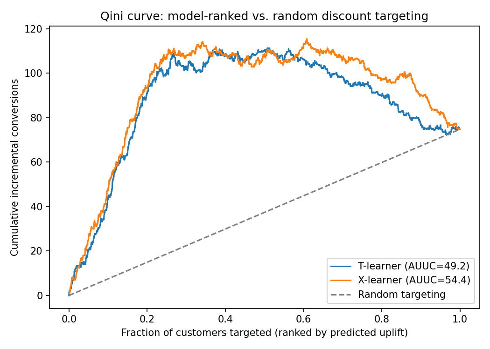

# discount-uplift

[](https://github.com/niki-kandlikar/discount-uplift/actions/workflows/tests.yml)

Predicting who a discount actually *changes the mind of*, not just who's likely to buy.

## The problem

Say you're a merchant deciding who gets a 10%-off cart-abandonment email. The obvious approach is a conversion model: score every customer on P(buy), send the discount to the highest scorers. The problem is that P(buy) doesn't tell you what you actually want to know, which is whether the discount *caused* the purchase. A lot of your highest scorers were going to buy anyway — you're just cutting into margin on sales you'd have gotten for free. A smaller number of customers are the reverse: on the fence, and the discount is what tips them over. And some customers, especially heavy discount-seekers, actually convert *less* when they smell a promo coming, because it signals "wait for a better deal."

This is a causal inference problem, not a classification problem, and it needs a different kind of model and a different kind of evaluation.

## Approach

Two uplift models, both implemented from scratch on top of plain scikit-learn estimators (deliberately not using `causalml`/`econml` — the point of this project was to understand the mechanics, not call a library):

- **T-learner**: one model trained on treated customers, one on control. Uplift = difference in their predictions. Simple, and it's the natural first thing to try, but each model only sees half the data and small independent errors in the two models don't cancel — see `src/models.py` for where this bites in practice.
- **X-learner**: addresses the T-learner's main weakness by imputing individual treatment effects in a second stage and blending them with a propensity model. More moving parts, generally more robust when the treatment effect is small relative to noise.

Evaluated with the **Qini curve** (Radcliffe, 2007) — rank customers by predicted uplift, and check whether targeting the top-k actually produces a bigger treated-vs-control conversion gap than targeting randomly. This only works because treatment was randomized in the underlying data, which is what makes it possible to check at all — you cannot validate a causal claim against non-experimental data without much stronger assumptions.



X-learner comes out ahead on AUUC in this run (54.4 vs. 49.2) — consistent with what the uplift-modeling literature would predict for a case like this, where the treatment effect is a fairly small perturbation on top of a noisier base conversion rate.

## Data

Built against the schema of the [Criteo Uplift Modeling Dataset](https://ailab.criteo.com/criteo-uplift-prediction-dataset/) (12 anonymized features, randomized treatment, binary outcome) — this is the standard public benchmark for uplift modeling and is itself derived from real ad-targeting experiments. It's not bundled here (it's a multi-hundred-MB download under its own usage terms), so `src/data.py` also has `make_synthetic_data()`, which generates data with known, deliberately heterogeneous treatment effects (persuadables, sure-things, lost-causes, and "sleeping dogs" who convert *less* when treated) so the models and the Qini evaluation have something real to recover — and so tests and CI don't depend on a large external download. Point `scripts/train.py --data <path>` at a real CSV to use it instead.

## Structure

```
src/
  data.py       # synthetic data generator + real-data loader
  models.py     # T-learner, X-learner
  evaluate.py   # Qini curve, AUUC
  api.py        # FastAPI scoring endpoint
scripts/
  train.py      # train, compare models, save the winner
  plot_qini.py  # generate the Qini curve plot above
tests/
docs/
  qini_curve.png
```

## Running it

```bash
pip install -r requirements.txt
python scripts/train.py --synthetic     # trains both models, saves the winner
python scripts/plot_qini.py             # regenerates docs/qini_curve.png
uvicorn src.api:app --reload            # scoring API on :8000
pytest tests/                           # 9 tests, ~7s (also run by GitHub Actions on every push)
```

```bash
curl -X POST localhost:8000/score -H "Content-Type: application/json" \
  -d '{"features": [1.2, -0.8, 0.3, 0.1, 0.5, -0.2, 0.0, 0.4, -0.1, 0.2, 0.3, -0.5]}'
```

Or via Docker: `docker build -t discount-uplift . && docker run -p 8000:8000 discount-uplift`.

## Limitations

- Criteo's features are anonymized (f0-f11 with no semantic meaning), so a model trained on it doesn't transfer to a real merchant's actual customer features without redoing feature engineering from scratch — this project validates the *method*, not a deployable model.
- `recommend_treatment` in the API thresholds at uplift > 0, which ignores discount cost. A real deployment needs to weight predicted uplift against margin lost on customers who'd have converted anyway — that's a straightforward extension (compare uplift × margin against discount cost) but it's not implemented here.
- The X-learner's propensity-based blending assumes the propensity model is reasonably well-calibrated; I didn't add a calibration check, which I'd want before trusting this past a synthetic benchmark.
- No hyperparameter tuning was done on either learner — both use scikit-learn's `GradientBoostingClassifier`/`Regressor` defaults with only `n_estimators`/`max_depth` set. AUUC is sensitive to this and a tuned model would likely widen the gap between the two approaches.
